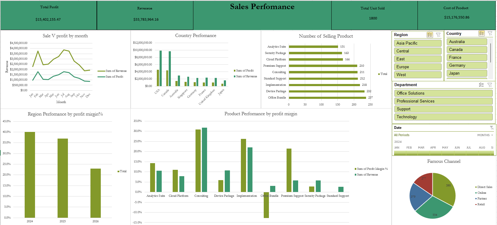

# 📊 Financial Sales Performance Dashboard — Excel

## Dashboard Preview

## Project Overview

| Item | Details |
|---|---|
| Project | Financial Sales Performance Dashboard |
| Tool | Microsoft Excel |
| Records | 1,800 transactions |
| Period | 2024–2026 |
| Main Analysis | Revenue, Profit, COGS, Profit Margin, Products, Countries, Regions and Sales Channels |
| Excel Features | PivotTables, PivotCharts, KPI Cards, Slicers, Timeline and Calculated Metrics |
| Goal | Turn raw financial sales data into an interactive dashboard for business performance analysis |

## Key Performance Indicators

| KPI | Result |
|---|---:|
| Total Revenue | **$33,783,964.16** |
| Total Profit | **$15,402,155.47** |
| Cost of Goods Sold (COGS) | **$15,176,550.86** |
| Operating Expenses | **$3,205,257.83** |
| Overall Profit Margin | **45.59%** |
| Total Units Sold | **38,365** |
| Total Transactions | **1,800** |
| Budget Revenue | **$33,703,408.67** |
| Revenue Variance vs Budget | **+$80,555.49** |

> **Dashboard note:** the KPI currently showing **1,800** represents the number of transactions. If you want a true **Total Units Sold** KPI, use **38,365**.

## Annual Performance

| Year | Revenue | Profit | Profit Margin | Transactions | Units Sold |
|---:|---:|---:|---:|---:|---:|
| 2024 | $11.99M | $5.50M | 45.85% | 644 | 13,490 |
| 2025 | **$12.71M** | **$5.99M** | **47.11%** | 653 | 14,079 |
| 2026 | $9.08M | $3.91M | 43.12% | 503 | 10,796 |

| Annual Insight | Finding |
|---|---|
| Strongest year | **2025** produced the highest revenue and profit. |
| Highest annual margin | **2025 — 47.11%** |
| 2026 comparison | 2026 contains fewer transactions than 2024 and 2025, so the yearly result should be interpreted with its available date coverage in mind. |

## Monthly Performance

| Month | Revenue | Profit | Profit Margin | Transactions |
|---|---:|---:|---:|---:|
| Jan | $2.26M | $0.98M | 43.55% | 164 |
| Feb | $3.74M | $1.79M | **47.86%** | 165 |
| Mar | $2.43M | $1.07M | 43.77% | 146 |
| Apr | $2.51M | $1.04M | 41.57% | 137 |
| May | $2.96M | $1.34M | 45.31% | 165 |
| Jun | $3.24M | $1.50M | 46.33% | 165 |
| Jul | **$3.87M** | **$1.79M** | 46.38% | 180 |
| Aug | $3.74M | $1.70M | 45.55% | **206** |
| Sep | $2.80M | $1.28M | 45.88% | 140 |
| Oct | $2.43M | $1.16M | 47.59% | 112 |
| Nov | $1.87M | $0.88M | 47.05% | 111 |
| Dec | $1.94M | $0.86M | 44.44% | 109 |

| Monthly Insight | Finding |
|---|---|
| Highest revenue month | **July — $3.87M** |
| Highest profit month | **July — $1.79M** |
| Most transactions | **August — 206** |
| Highest monthly margin | **February — 47.86%** |

## Country Performance

| Country | Revenue | Profit | Profit Margin | Transactions | Units Sold |
|---|---:|---:|---:|---:|---:|
| USA | **$9.89M** | **$4.53M** | 45.80% | **536** | **11,101** |
| Canada | $9.71M | $4.39M | 45.24% | 521 | 10,940 |
| Australia | $2.97M | $1.45M | **48.95%** | 124 | 2,966 |
| Singapore | $2.60M | $1.18M | 45.46% | 124 | 2,927 |
| France | $2.36M | $1.05M | 44.54% | 132 | 3,079 |
| Germany | $2.32M | $1.09M | 47.14% | 108 | 2,364 |
| United Kingdom | $2.31M | $1.04M | 44.90% | 131 | 2,522 |
| Japan | $1.63M | $0.67M | 40.77% | 124 | 2,466 |

| Country Insight | Finding |
|---|---|
| Highest revenue | **USA — $9.89M** |
| Highest profit | **USA — $4.53M** |
| Highest profit margin | **Australia — 48.95%** |
| Second-largest market | **Canada — $9.71M revenue** |

## Region Performance

| Region | Revenue | Profit | Profit Margin | Transactions | Units Sold |
|---|---:|---:|---:|---:|---:|
| East | **$7.63M** | **$3.55M** | 46.54% | 353 | 8,352 |
| Asia Pacific | $7.20M | $3.30M | 45.83% | 372 | **8,359** |
| Europe | $6.99M | $3.18M | 45.52% | 371 | 7,965 |
| West | $6.07M | $2.85M | **46.96%** | 346 | 6,663 |
| Central | $5.89M | $2.52M | 42.72% | 358 | 7,026 |

| Region Insight | Finding |
|---|---|
| Highest revenue | **East — $7.63M** |
| Highest profit | **East — $3.55M** |
| Highest profit margin | **West — 46.96%** |
| Lowest profit margin | **Central — 42.72%** |

## Product Performance

| Product | Revenue | Profit | Profit Margin | Transactions | Units Sold |
|---|---:|---:|---:|---:|---:|
| Consulting | **$10.73M** | **$6.30M** | **58.70%** | 211 | 4,960 |
| Implementation | $7.47M | $3.91M | 52.32% | 218 | 4,560 |
| Device Package | $3.60M | $0.63M | 17.44% | 232 | 5,009 |
| Analytics Suite | $3.56M | $1.41M | 39.59% | 151 | 3,370 |
| Cloud Platform | $2.65M | $1.07M | 40.25% | 166 | 3,371 |
| Security Package | $1.95M | $0.58M | 29.59% | 163 | 3,503 |
| Premium Support | $1.93M | $1.05M | 54.48% | 210 | 4,367 |
| Office Bundle | $1.02M | $0.12M | **11.29%** | **237** | **5,032** |
| Standard Support | $0.87M | $0.34M | 39.63% | 212 | 4,193 |

| Product Insight | Finding |
|---|---|
| Highest revenue | **Consulting — $10.73M** |
| Highest profit | **Consulting — $6.30M** |
| Highest profit margin | **Consulting — 58.70%** |
| Most frequently sold | **Office Bundle — 237 transactions** |
| Most units sold | **Office Bundle — 5,032 units** |
| Lowest profit margin | **Office Bundle — 11.29%** |
| Key takeaway | The most frequently sold product is **not** the most profitable product. |

## Department Performance

| Department | Revenue | Profit | Profit Margin | Transactions | Units Sold |
|---|---:|---:|---:|---:|---:|
| Professional Services | **$18.20M** | **$10.21M** | **56.09%** | 429 | 9,520 |
| Technology | $8.17M | $3.06M | 37.41% | **480** | **10,244** |
| Office Solutions | $4.62M | $0.74M | 16.08% | 469 | 10,041 |
| Support | $2.80M | $1.40M | 49.89% | 422 | 8,560 |

## Sales Channel Performance

| Sales Channel | Revenue | Profit | Profit Margin | Transactions | Units Sold |
|---|---:|---:|---:|---:|---:|
| Direct Sales | **$11.33M** | **$5.15M** | 45.44% | **590** | **12,731** |
| Online | $9.82M | $4.38M | 44.56% | 554 | 11,994 |
| Partner | $7.10M | $3.28M | 46.13% | 379 | 7,617 |
| Retail | $5.53M | $2.60M | **47.03%** | 277 | 6,023 |

| Channel Insight | Finding |
|---|---|
| Highest revenue | **Direct Sales — $11.33M** |
| Highest profit | **Direct Sales — $5.15M** |
| Most transactions | **Direct Sales — 590** |
| Highest profit margin | **Retail — 47.03%** |

## Dashboard Components

| Dashboard Element | Purpose |
|---|---|
| Total Profit KPI | Shows total business profit |
| Revenue KPI | Shows total sales revenue |
| Transaction KPI | Shows total number of sales records |
| Cost of Product KPI | Shows total COGS |
| Monthly Revenue vs Profit Chart | Tracks business performance over time |
| Country Performance Chart | Compares revenue and profit by country |
| Number of Selling Product Chart | Compares product sales frequency |
| Annual Profit Margin Chart | Compares profitability by year |
| Product Profitability Chart | Identifies strong and weak products |
| Sales Channel Pie Chart | Shows transaction distribution by channel |
| Region Slicer | Filters the entire dashboard by region |
| Country Slicer | Filters the dashboard by country |
| Department Slicer | Filters by business department |
| Date Timeline | Filters performance by time period |

## Calculated Metrics

| Metric | Formula |
|---|---|
| Revenue | `Units Sold × Unit Price × (1 - Discount %)` |
| COGS | `Units Sold × Unit Cost` |
| Profit | `Revenue - COGS - Operating Expense` |
| Profit Margin % | `Profit ÷ Revenue` |
| Revenue Variance | `Revenue - Budget Revenue` |

## Business Recommendations

| Area | Recommendation |
|---|---|
| Product strategy | Continue prioritizing **Consulting** and **Implementation**, which combine high revenue with strong margins. |
| Low-margin products | Review **Office Bundle** pricing, discounts, unit costs and operating expenses because its margin is only **11.29%**. |
| Geographic strategy | Maintain focus on the **USA and Canada**, while evaluating expansion opportunities in high-margin markets such as **Australia**. |
| Regional strategy | Investigate why **Central** has the lowest regional margin at **42.72%**. |
| Sales channels | Keep Direct Sales as a major revenue channel while studying why Retail achieves the highest channel margin. |
| Forecasting | Use monthly sales trends, especially strong months such as **July and August**, to improve planning and budgeting. |
| Performance management | Track actual revenue against budget continuously to identify negative variance early. |

## Excel Skills Demonstrated

| Skill Area | Techniques Used |
|---|---|
| Data Analysis | Aggregation, profitability analysis, comparison and trend analysis |
| PivotTables | Revenue, profit, products, countries, years and channels |
| PivotCharts | Line, column, bar and pie charts |
| Dashboard Design | KPI cards, chart layout and executive summary view |
| Interactivity | Slicers and timeline filtering |
| Financial Analysis | Revenue, COGS, operating expense, profit and margin analysis |
| Business Storytelling | Converting raw data into actionable findings and recommendations |

## Future Improvements

| Improvement | Purpose |
|---|---|
| Year-over-Year Growth | Measure annual growth in revenue and profit |
| Discount Impact Analysis | Determine how discounts affect margins |
| Customer Segment Analysis | Identify the most profitable customer groups |
| Budget Variance Dashboard | Compare actual performance against targets |
| Top/Bottom Product Ranking | Quickly identify strongest and weakest products |
| Forecasting | Estimate future sales and profit trends |
| Power BI Version | Rebuild the analysis with more advanced interactivity |

## Tools Used

| Tool | Usage |
|---|---|
| Microsoft Excel | Data analysis and dashboard creation |
| PivotTables | Data summarization |
| PivotCharts | Data visualization |
| Slicers | Interactive filtering |
| Timeline | Date-based filtering |
| KPI Cards | Executive-level performance summary |

## Author

| | |
|---|---|
| Name | **Mohammad** |
| Portfolio | https://mohammad0104.github.io/ |
